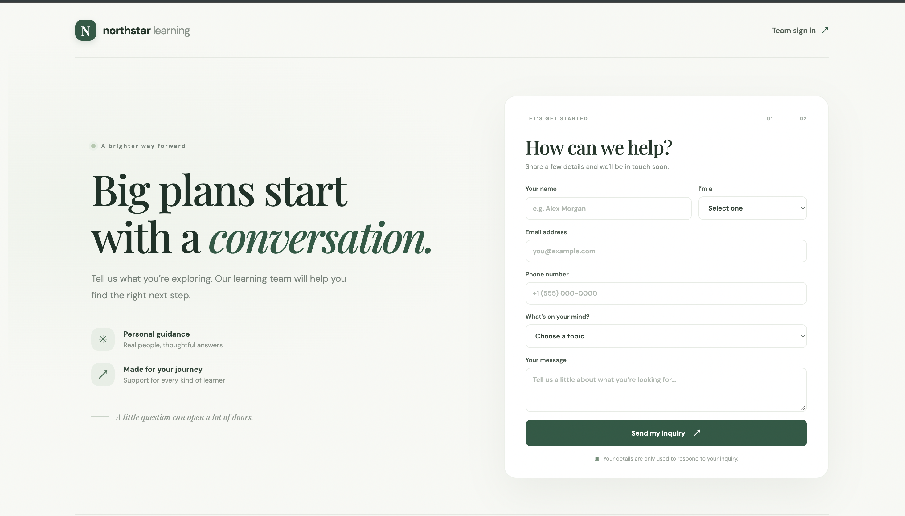
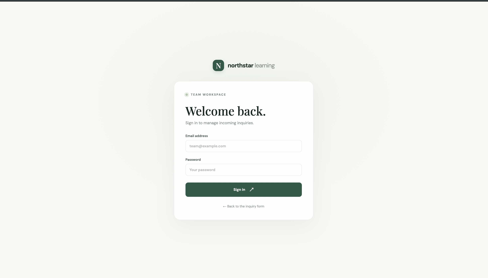
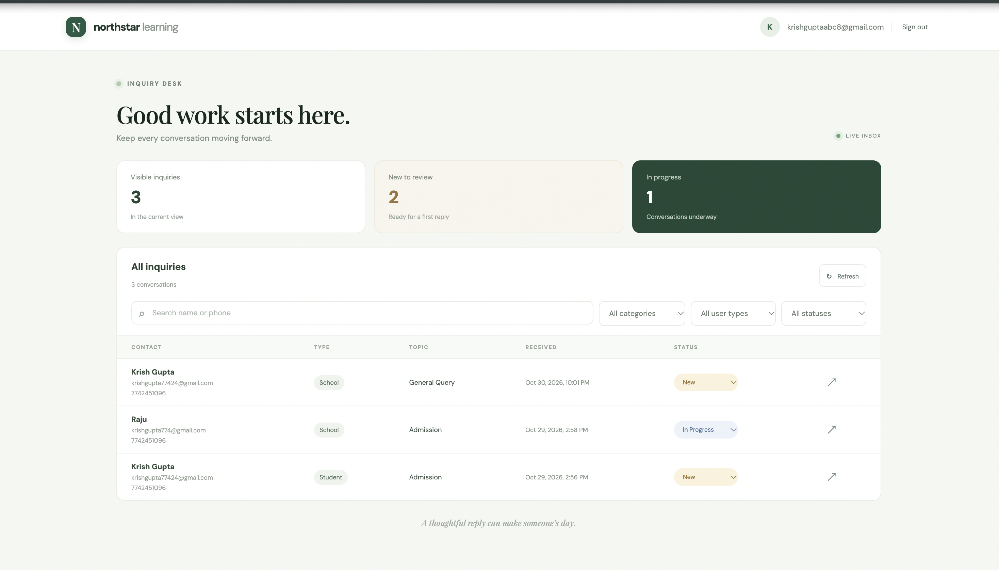

# Northstar Learning — EdTech CRM & Inquiry System

A full-stack EdTech CRM and inquiry management platform built as part of a full-stack development assessment. The platform enables parents, students, and schools to submit inquiries through a public form, while administrators can securely manage, search, filter, and track inquiries through a dedicated dashboard.

## Live Demo

| Resource | Link |
|---|---|
| Live Application | [Open Northstar Learning](https://edtech-crm-git-main-krishgupta102s-projects.vercel.app) |
| Admin Dashboard | [Open Admin Dashboard](https://edtech-crm-git-main-krishgupta102s-projects.vercel.app/admin) |
| Backend API | [Render API](https://edtech-crm-lm0l.onrender.com) |
| API Health Check | [Check API Health](https://edtech-crm-lm0l.onrender.com/api/health) |
| GitHub Repository | [View Source Code](https://github.com/Krishgupta102/edtech-crm) |

## Screenshots

### 1. Public Inquiry Form

The public-facing inquiry form allows parents, students, and schools to submit their queries by selecting an appropriate user type and inquiry category.



### 2. Admin Login

A secure administrator login interface using custom JWT-based authentication and bcrypt password verification.



### 3. Admin Dashboard

The centralized dashboard allows administrators to view submitted inquiries, search by name or phone number, filter records, review messages, and update inquiry statuses.



## Features

### 1. Public Inquiry Management

- Responsive inquiry submission form.
- Three user types: Parent, Student, and School.
- Four inquiry categories: Scholarship, Concert, Admission, and General Query.
- Collection of name, email, phone number, and inquiry message.
- Client-side and server-side input validation.
- Successful submissions are stored directly in Supabase PostgreSQL.
- Submission feedback and error handling.

### 2. Admin Authentication

- Custom JWT-based authentication implemented in the Express backend.
- Password hashing and verification using bcrypt.
- HTTP-only authentication cookies.
- Protected admin routes using JWT verification middleware.
- Eight-hour JWT expiration.
- Login rate limiting.
- Secure logout functionality.
- Admin session verification.

**Note:** Supabase Auth is not used. Authentication is implemented independently in the backend, as required by the assessment.

### 3. Admin Dashboard

- View submitted inquiries in a centralized dashboard.
- Display inquiry details, including name, email, phone, user type, category, submission date, and status.
- Search inquiries by name or phone number.
- Filter inquiries by category.
- Filter inquiries by user type.
- Review individual inquiry messages.
- Update inquiry statuses.
- View the latest 300 matching inquiries.

## Technology Stack

| Layer | Technologies |
|---|---|
| Frontend | Next.js 15, React 19, TypeScript |
| Styling | CSS, Responsive Design |
| Backend | Node.js, Express.js, TypeScript |
| Database | Supabase PostgreSQL |
| Database Connectivity | PostgreSQL `pg` driver |
| Authentication | JWT, bcryptjs, HTTP-only Cookies |
| Validation | Zod |
| Security | Helmet, CORS, Express Rate Limit |
| Deployment | Vercel, Render, Supabase |
| Version Control | Git, GitHub |

## Architecture

The application follows a separated frontend and backend architecture using an npm workspaces monorepo.

```text
                      USER
                        |
                        v
               Next.js Frontend
                    (Vercel)
                        |
                  REST API Calls
                        |
                        v
                Express Backend
                    (Render)
                        |
              +---------+---------+
              |                   |
              v                   v
        Authentication       Inquiry APIs
          JWT + bcrypt       Validation
              |                   |
              +---------+---------+
                        |
                        v
               Supabase PostgreSQL
                        |
                 +------+------+
                 |             |
                 v             v
               admins      inquiries
```

### Request Flow

1. A user submits an inquiry through the Next.js frontend.
2. The frontend sends a request to the Express REST API.
3. The backend validates the submitted data using Zod.
4. Valid inquiries are inserted into Supabase PostgreSQL.
5. An administrator logs in using email and password.
6. The backend verifies the password against its bcrypt hash and issues a JWT.
7. The JWT is stored in an HTTP-only cookie.
8. Protected dashboard requests are authenticated through middleware.
9. The backend retrieves, filters, searches, and updates inquiry records.

## Project Structure

```text
edtech-crm/
│
├── apps/
│   ├── api/
│   │   ├── src/
│   │   │   ├── server.ts
│   │   │   ├── validation.ts
│   │   │   ├── validation.test.ts
│   │   │   └── create-admin.ts
│   │   ├── package.json
│   │   └── tsconfig.json
│   │
│   └── web/
│       ├── app/
│       ├── components/
│       ├── public/
│       ├── package.json
│       └── next.config.ts
│
├── database/
│   └── schema.sql
│
├── images/
│   ├── public-inquiry-form.png
│   ├── admin-login.png
│   └── admin-dashboard.png
│
├── .env.example
├── .gitignore
├── package.json
├── package-lock.json
└── README.md
```

## Requirements

- Node.js 20 or newer.
- npm 10 or newer.
- A Supabase project.
- Git and GitHub account.

## Local Installation and Setup

### 1. Clone the repository

```bash
git clone https://github.com/Krishgupta102/edtech-crm.git

cd edtech-crm
```

### 2. Install dependencies

Run from the project root:

```bash
npm install
```

### 3. Configure Supabase

1. Create a Supabase project.
2. Open the SQL Editor.
3. Copy the contents of `database/schema.sql`.
4. Execute the SQL script.
5. Verify that the `admins` and `inquiries` tables have been created.
6. Copy your PostgreSQL connection string from Supabase.

Use the Session Pooler connection string if direct database connectivity is unavailable in your environment. Keep database credentials private.

### 4. Configure environment variables

Copy `.env.example` into the backend environment file:

```bash
cp .env.example apps/api/.env
```

Set the following variables:

```env
DATABASE_URL=your_supabase_postgresql_connection_string
JWT_SECRET=your_long_random_secret
API_PORT=4000
WEB_ORIGIN=http://localhost:3000
NODE_ENV=development
```

Generate a secure JWT secret using:

```bash
openssl rand -base64 48
```

Create the frontend environment file:

```bash
cp .env.example apps/web/.env.local
```

Set:

```env
NEXT_PUBLIC_API_URL=http://localhost:4000/api
```

Never commit `.env` or `.env.local` files to GitHub.

### 5. Create the initial admin account

Run:

```bash
npm run admin:create
```

The script prompts for the administrator's email and password, hashes the password using bcrypt, and inserts the admin account into the database.

Use a strong password of at least 12 characters.

### 6. Start the application

Run both applications simultaneously:

```bash
npm run dev
```

Open the following URLs:

| Application | URL |
|---|---|
| Public Inquiry Form | http://localhost:3000 |
| Admin Dashboard | http://localhost:3000/admin |
| Backend Health Check | http://localhost:4000/api/health |

## Environment Variables

| Variable | Application | Description |
|---|---|---|
| `DATABASE_URL` | API | Supabase PostgreSQL connection string |
| `JWT_SECRET` | API | Secret used to sign and verify JWTs; minimum 32 characters |
| `API_PORT` | API | API server port; defaults to 4000 |
| `WEB_ORIGIN` | API | Exact frontend origin allowed by CORS |
| `NODE_ENV` | API | Application environment |
| `NEXT_PUBLIC_API_URL` | Web | Backend API base URL, including `/api` |

For production, configure the API with `NODE_ENV=production` and set `WEB_ORIGIN` to the exact HTTPS origin of the deployed frontend, without a trailing slash.

The frontend and backend use separate domains, so production authentication cookies are configured with `Secure`, `HttpOnly`, and `SameSite=None`.

## API Documentation

The backend exposes the following REST API endpoints:

| Method | Endpoint | Access | Description |
|---|---|---|---|
| POST | `/api/inquiries` | Public | Submit an inquiry |
| POST | `/api/admin/login` | Public | Authenticate admin and issue JWT cookie |
| POST | `/api/admin/logout` | Public | Clear authentication cookie |
| GET | `/api/admin/me` | Protected | Verify current admin session |
| GET | `/api/admin/inquiries` | Protected | Retrieve and filter inquiries |
| PATCH | `/api/admin/inquiries/:id/status` | Protected | Update an inquiry status |
| GET | `/api/health` | Public | Check API and database connectivity |

### Inquiry Filtering and Search

The admin inquiry endpoint supports the following query parameters:

- `category` — Filter by inquiry category.
- `userType` — Filter by Parent, Student, or School.
- `status` — Filter by inquiry status.
- `search` — Search by name or phone number.

Example:

```http
GET /api/admin/inquiries?category=Admission&userType=Parent&search=Rahul
```

Admin authentication is required for this endpoint.

## Security Implementation

Security has been considered across the frontend, backend, and database layers.

- **Password Security:** Passwords are hashed using bcryptjs before being stored in PostgreSQL.
- **JWT Authentication:** Custom JWT generation and verification using `jsonwebtoken`.
- **HTTP-only Cookies:** Authentication tokens are stored in HTTP-only cookies rather than browser-accessible JavaScript storage.
- **Protected Routes:** Admin endpoints use authentication middleware to verify JWTs.
- **Input Validation:** Zod validates incoming inquiry and login data.
- **SQL Injection Prevention:** Parameterized PostgreSQL queries are used for database operations.
- **Rate Limiting:** Public inquiry submissions and login attempts are rate limited.
- **Security Headers:** Helmet is used to configure HTTP security headers.
- **CORS:** Cross-origin requests are restricted to the configured frontend origin.
- **Environment Variables:** Database credentials and JWT secrets are maintained outside the source code.

## Testing

Run automated backend validation tests:

```bash
npm test
```

Build both applications:

```bash
npm run build
```

The automated tests cover inquiry field validation and login input validation.

### Manual Testing Checklist

| Test Case | Expected Result |
|---|---|
| Submit valid inquiry | Inquiry saved successfully |
| Submit invalid inquiry | Validation error returned |
| Login with valid admin credentials | Authentication successful |
| Login with incorrect credentials | HTTP 401 response |
| Access protected endpoint without login | HTTP 401 response |
| Search by name | Matching inquiries returned |
| Search by phone | Matching inquiries returned |
| Filter by category | Matching category records returned |
| Filter by user type | Matching user-type records returned |
| Update inquiry status | Status updated in database |
| Logout | Authentication cookie cleared |
| Database health check | Successful database connectivity response |

## Deployment

The application is deployed using Vercel, Render, and Supabase.

### 1. Database — Supabase

- Create a Supabase PostgreSQL project.
- Execute `database/schema.sql`.
- Obtain the PostgreSQL connection string.
- Configure `DATABASE_URL` in the backend hosting environment.

### 2. Backend — Render

Create a Node.js Web Service connected to the GitHub repository.

Because this project uses npm workspaces, configure the service as follows:

| Setting | Value |
|---|---|
| Root Directory | Leave blank (repository root) |
| Runtime | Node.js |
| Build Command | `npm ci --include=dev && npm run build --workspace=@edtech-crm/api` |
| Start Command | `npm run start --workspace=@edtech-crm/api` |

Configure these environment variables in Render:

```env
DATABASE_URL=your_supabase_connection_string
JWT_SECRET=your_production_secret
WEB_ORIGIN=https://your-vercel-domain.vercel.app
NODE_ENV=production
```

The API is deployed at:

https://edtech-crm-lm0l.onrender.com

Health check:

https://edtech-crm-lm0l.onrender.com/api/health

### 3. Frontend — Vercel

Import the GitHub repository into Vercel.

Configure:

| Setting | Value |
|---|---|
| Framework Preset | Next.js |
| Root Directory | `apps/web` |
| Build Command | `next build` |
| Output Directory | Default |

Add the following environment variable:

```env
NEXT_PUBLIC_API_URL=https://edtech-crm-lm0l.onrender.com/api
```

Deploy the application and update `WEB_ORIGIN` in Render to match the actual Vercel production domain.

After deployment, test the inquiry submission, authentication, dashboard, search, filters, and status updates.

### 4. Provisioning the Production Admin

Create the first production admin account using the existing admin creation script:

```bash
npm run admin:create
```

Run this from a trusted environment configured with the production database connection string, or an appropriately configured deployment shell.

Do not commit production admin credentials or database secrets to the repository.

## Assessment Evaluation Guide

The following functionality is available for evaluation:

1. Open the public application and submit an inquiry.
2. Navigate to the admin login page.
3. Sign in using the separately provided evaluator credentials.
4. View submitted inquiries in the dashboard.
5. Test category and user-type filters.
6. Search inquiries using a name or phone number.
7. Open and review inquiry messages.
8. Change inquiry statuses.
9. Log out and verify that protected dashboard access requires authentication.

**Admin Demo Credentials:** Shared separately with the evaluator for security. No administrator password or secret is committed to the repository.

## Current Limitations and Future Improvements

The current implementation focuses on the assessment's core requirements.

Potential improvements include:

- Server-side pagination for larger inquiry datasets.
- Inquiry assignment to individual administrators.
- CSV export for inquiry records.
- Dashboard analytics and inquiry statistics.
- Email notifications for new inquiries.
- Advanced inquiry activity history.
- Admin role management and audit logs.

## Author

**Krish Gupta**

Integrated M.Tech — Computer Science

GitHub: https://github.com/Krishgupta102

Portfolio: https://portfolio-krish-gupta-nine.vercel.app/

---

Built with Next.js, Express, TypeScript, and Supabase PostgreSQL.